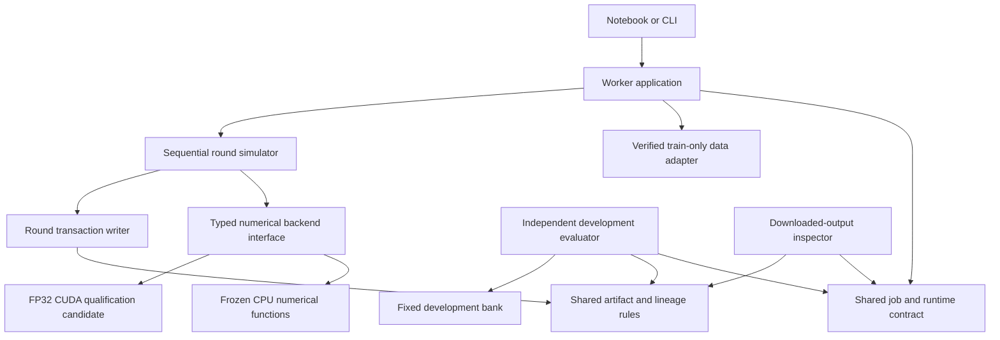

# Architecture decision and implementation review

25 October 2026. This delivery strengthens the software architecture of the
Phase 3 Kaggle candidate. It does not claim a universally best neural network or
change the frozen research methods. Changes to the model, objective, precision,
sampling, gates or doses still need controlled development and a prospective
version. Actual Kaggle device qualification remains pending.

## Chosen structure

The design is a modular sequential simulator with explicit input contracts,
small numerical adapters and a separate artifact/evaluation boundary. Each job
simulates all five FL clients. Independent paired seed jobs are the unit of
contributor scheduling.

The interface uses Python's
[structural protocol mechanism](https://typing.python.org/en/latest/reference/protocols.html).
The CPU adapter delegates to the original functions. The simulator owns stage
and round sequencing; backend implementations own device-specific numerical
work. Artifact inspection has no training or inference entry point.

## Newly identified weaknesses and fixes

| Priority | Finding | Implemented change |
|---|---|---|
| P1 | Worker, evaluator and importer repeated different subsets of validation. The importer did not enforce all current protocol/decision/taxonomy identities. | `contracts.py` supplies one strict producer/consumer contract. Every boundary checks the same revision, actual frozen engine, configuration hashes, installed runtime, settings, data-manifest digest and final seal. |
| P1 | Loose JSON values could treat Boolean or floating values as integer seeds/counts; recomputed hashes alone did not validate the intended runtime policy. | Exact field schemas and primitive types reject unsupported seeds/doses/budgets, unknown fields, nonfinite coefficients, wrong precision/threads, inconsistent CUDA claims and package fingerprints. |
| P1 | A success receipt did not recheck source/configuration and inputs at its publication boundary. | Publishing validates the current contract again and invokes the data adapter's integrity capability. A failure retains states and cannot acquire a success receipt. |
| P2 | Checkpoint scanning and lineage checks were duplicated and ordered differently. | `artifacts.py` owns canonical references, contiguous prefix/complete indexing, cursor/registry/ledger checks and receipt rules. Worker, evaluator and importer share those rules. |
| P2 | A partial receipt could hide later checkpoints written before a crash. | Import reports unreceipted checkpoints explicitly. An incomplete record is not promoted to verified completion. Completed receipts reject unexpected artifacts. |
| P2 | Device branches were embedded in the simulation loop. | A small typed backend interface isolates CPU/CUDA adaptation. Admission, training and importance calls use one port; fixed-order server aggregation stays unchanged. |
| P2 | Generic CI used Python 3.11 and broad package ranges for tests requiring the pinned Phase 3 runtime. | A separate read-only CPU qualification workflow uses Python 3.12.14, hash-locked dependencies and synthetic tests. Legacy CI keeps its environment and routes Phase 3 qualification to the dedicated job. Actions are pinned to verified commits. |
| P2 | Git line-ending conversion could invalidate exact source/evidence identities across machines. | `.gitattributes` preserves exact bytes for scientific source, bound scripts/tests, configuration and evidence; no frozen working file is rewritten. |

The runtime remains isolated and hash-locked following
[uv's exact synchronization and hash requirements](https://docs.astral.sh/uv/pip/compile/).
The GitHub action pins were checked against the official
[checkout](https://github.com/actions/checkout/commit/11bd71901bbe5b1630ceea73d27597364c9af683),
[setup-python](https://github.com/actions/setup-python/commit/a26af69be951a213d495a4c3e4e4022e16d87065)
and [upload-artifact](https://github.com/actions/upload-artifact/commit/ea165f8d65b6e75b540449e92b4886f43607fa02)
releases. The workflow is prepared locally; no remote CI run has occurred.

## Reliability model

A job first validates its source/runtime/settings contract and the full training
package. Committed checkpoints form a contiguous immutable prefix. Resume checks
existing receipt payloads and checkpoint history before taking the next round.
At publication, source/configuration and input integrity are checked again. A
complete checkpoint set missing its receipt can be reconciled without training
again. Retries of uncommitted work remain physical attempts, never new seeds.

This is idempotent handling of committed local work, not a claim of exactly-once
execution across eight contributors. Contributor-wide final dispatch and
duplicate/conflict resolution still require the final frozen job matrix and
result catalog. Current artifacts remain qualification-only.

The data adapter exposes immutable supplied-label stage inputs to the learner.
Builder/oracle metadata and final-test features are not learner inputs. The
independent evaluator accepts the exact development-bank digest. Integrity
hashes support reproducibility and corruption detection; they are not hardware
attestation or protection against a malicious execution host.

## Techniques retained or deferred with reasons

Stage/target caching, vectorized label mapping, bounded device tensors, streaming
evaluation, finite checks, fixed-order aggregation and complete RNG recovery are
retained. Earlier measured improvements are documented in
[the v2 review](review-v2.md); their component speedups do not imply a measured
whole-study or GPU speedup.

Actual GPU optimization will use complete job profiles and
[PyTorch's profiler](https://docs.pytorch.org/tutorials/beginner/profiler.html).
[PyTorch's tuning guidance](https://docs.pytorch.org/tutorials/recipes/recipes/tuning_guide.html)
identifies host/device synchronization as a possible bottleneck; its importance
for this simulator must be measured on the target GPU.

Asynchronous distributed checkpointing is deferred. The modern
[asynchronous staging helper](https://docs.pytorch.org/tutorials/recipes/distributed_async_checkpoint_recipe.html)
requires a newer framework than the pinned Torch 2.7 runtime, adds background
work, and requires careful staging/mutation barriers. Current small synchronous
round transactions preserve the accepted recovery semantics.

No new service/database/message broker is required to execute one small
simulator. Multiple contributors can execute independent paired blocks after
runtime and scope qualification. Broad repository packaging modernization,
final-study ablations/oracle interventions, actual GPU profiling and the final
multi-worker result catalog remain separately scoped work.

## Verification and current delivery

- [Strict contract/artifact tests](../../results/kaggle-readiness-v3/architecture-release-final.json) exercise malformed identities, runtime-policy inconsistencies, typed settings, unsafe paths, broken prefixes, receipt bindings, source/input guards and visible unreceipted states without executing a model.
- [Numerical regression](../../results/kaggle-readiness-v3/acceptance-final.json) checks exact CPU metadata/typed arrays/ledgers, CPU emulation of the CUDA adapter, poison fixtures and fresh-process recovery.
- [Recovery/performance regressions](../../results/kaggle-readiness-v3/review-final.json) retain the previous crash, environment-drift, streaming-memory and exact mapping checks.
- [Notebook QA](../../results/kaggle-readiness-v3/notebook-acceptance.json) is an offline control-flow test with explicitly mocked installation/model subprocesses; it is not an actual Kaggle run.
- [Completion and preservation record](../../results/kaggle-readiness-v3/completion.json) binds final source, bundle, notebook and evidence identities.

The current candidate uses separate v3 notebook/source/environment/output paths.
Earlier v1/v2 bundles and evidence remain preserved. The ongoing CPU study keeps
its original scientific identity and independent verification controller.

The final v3 snapshot passed **90 check groups: 55 contract/artifact, 30 numerical
and 5 recovery/performance groups**. All bind worker identity
`e6b7b61d4d2d57bef783dd937d8cf2f6dabeb1c7256b80e149733717f23849f8`.
The 78-file private bundle and four notebook code cells passed offline extraction
and default execution-flow verification. Installation/model subprocesses in the
notebook QA were mocked explicitly. Neither this QA nor the local CI YAML check
establishes actual Linux/CUDA performance. The release audit additionally checks
the unchanged scientific engine, all 32 controller-bound files and historical
v1/v2 bundle, notebook and report hashes.
