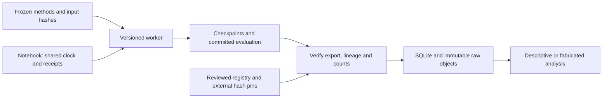

# Two-hour implementation and scientific-integrity audit

25 October 2026. Baseline commit: `1869d1b7c9de511ea091fd5b5b639165ffacdc93`.
Branch: `codex/phase3-continuation-readiness`. No default-branch push.
Requested interval: 12:34:23–14:34:23 UTC (17:34:23–19:34:23 Karachi).
The completion record gives the actual finish. Wall time includes tests,
inspection and documentation; it is not two CPU-hours of training.

## A. Executive verdict

The delivered CPU v3 scientific implementation and historical observations are
preserved. Corrections improve artifact integrity and Kaggle operation outside
the frozen numerical engine. Candidate **v5** supersedes v4 for new qualification.
Local acceptance does not qualify CUDA, provider storage, the twelve-seed study
or final-test inference. **Final-grid authorization remains blocked.**

Scientific identity remains
`38830e8b9e156c5c0db8285278de4666fca1c08b1d46e033f2009ef661e9e17c`.
Candidate v5 identity is
`768b1eceb5da05904f2ac3b183df5dab2721dfc73d7f974632e13adb1463c658`.
The original v4 ZIP and CPU source ZIP retain their hashes.

## B. Findings, highest severity first

Severity describes the consequence if exercised, not evidence of corrupted
published results. All 72 historical physical observations and nine aliases
pass the stricter validator.

| ID / severity | Weakness and consequence | Correction and acceptance | Status |
|---|---|---|---|
| T01 / high | The notebook gave each sequential job the full 7,200-second allowance; preceding work did not consume one shared budget | A monotonic `SessionBudget` starts before extraction, reserves export time and reduces each child timeout. Generated-cell tests stop the next long job after exhaustion | Fixed locally; provider timing pending |
| T02 / high | Source bindings recorded current protocol/decision/taxonomy hashes instead of rejecting changed frozen files | Pin all six frozen config/decision files and scientific identity before runtime binding or bundle construction; six mutation cases reject | Fixed; no frozen file edited |
| T03 / high | Bundle headers accepted inconsistent data identities and boolean/integer substitutions | Strict header inventory/types, pinned seed101 train/development identities and nested data manifest checks | Fixed; 82 payloads verified |
| T04 / high | Separate hash and parse reads could accept changed bytes under an earlier hash | Verify and parse one bounded byte snapshot; stream worker ZIPs into a private verified snapshot before inspection. Deterministic mutation tests pass | Fixed for supported import paths |
| T05 / high | Python boolean/numeric equality admitted typed settings/release mismatches; CPU parent and sidecar schema checks were incomplete | Exact canonical comparisons, required CPU schema and parent binding reject malformed records before observation creation | Fixed |
| T06 / high | Retry/alias paths could report success despite altered persisted condition/parent identity | Recheck condition ID, metric/run hashes, endpoints and alias parent before retry success | Fixed; normal retries add zero trajectories |
| T07 / medium | Some displayed class/binary/subgroup metrics were unchecked although core endpoints were reconstructed | Reconcile precision/recall/F1, binary rates, support status, labels and ordered benign subgroups with integer counts; undefined rates remain unavailable | Fixed; historical rows pass |
| T08 / medium | An existing evaluation directory was not an independently committed reusable artifact | Commit five payload hashes, job, bank and runtime. Reuse checks inventory and stage model/slots without repeat inference; preserve partial attempts separately | Fixed locally |
| T09 / medium | Export inspection and count import required a manual sequence | `worker_import` verifies a complete ZIP, checkpoint/evaluation bindings and every mapped count record before observation writes; external registry/archive pins are mandatory | Implemented for v5 development only; toy FT/EI/DR import and retry pass |
| T10 / medium | ZIP bounds did not inspect nested NPZ/NPY shape claims before allocation | Reject oversized JSON/log members, nested compression, object/structured arrays and impossible byte claims; require frozen model tensor shapes/dtypes | Fixed in verified importer; not a general sandbox |
| T11 / medium | Assembled-analysis fixtures emphasized null effects | Independent nonzero formulas verify all 348 paired differences; a missing clean reference keeps 12 contrasts unavailable in the same all_29 family | Added software evidence |
| T12 / medium | New pinned-runtime tests would otherwise run under generic Python 3.11 CI | Route exact tests to the existing Python 3.12.14/hash-locked workflow; retain generic checks for other tests | Local equivalent passes; hosted CI blocked |

Pre-fix reproductions and failed attempts are retained in
[the evidence directory](../../results/phase3-two-hour-audit-v1/).
The first export regression exposed Windows mandatory byte locking. Exports now
exclude and explicitly list runtime mutex files; scientific state is retained. A later seal-check edit exposed three synthetic
API compatibility errors in suite attempt4; the importer now uses the optional
revision field correctly. The failed log is retained and final acceptance uses
the subsequent complete suite. No assertion was weakened.

## C. Architecture and changes

The implementation separates frozen numerical methods, a versioned worker and
notebook orchestrator, immutable checkpoints/committed evaluations, and a
transactional count registry with a separate analysis assembler. The notebook
invokes modules and contains no training equations. No competing notebook or
training framework was added.

`session.py` centralizes OS locking, session deadlines, command receipts and
consistent streaming exports. Commands use explicit argument arrays and unique
attempt files. Failure handling stops the owned child process group, retains
logs and attempts export. Export holds worker locks and rechecks source hashes.
The 240-second export reservation is configurable, not a measured Kaggle
guarantee. Abrupt provider termination can still bypass Python cleanup.

`phase3_delivery/io.py`, `archive_policy.py`, `reported_metrics.py` and
`worker_import.py` strengthen transport and ingestion. The full requested batch
validates before the first write, but observations commit independently: a
storage failure can leave earlier accepted rows. The error identifies those
rows and an idempotent retry adds no replicates.

The importer checks prediction payload hashes and metric/model bindings. It
does not independently recompute private development labels or predictions.
Existing CPU prediction/count qualification provides separate evidence. Hashes
are integrity checks, not proof of honest reporting or an authenticated audit
trail against an administrator who can rewrite local files. Keep each catalog
and its `.objects` directory together; do not copy an open SQLite database.

[Change inventory](../../results/phase3-two-hour-audit-v1/change-inventory-staged-final.json)
lists modified implementation, tests, workflows and documents. The frozen
analysis engine, all_29 family, seeds, doses, gates and selected settings remain.
No numerical-equation rewrite, AMP, TF32 or seed pruning was introduced.

## D. Verification

See [acceptance](../../results/phase3-two-hour-audit-v1/acceptance-staged-final.json)
and [command ledger](../../results/phase3-two-hour-audit-v1/verification.json).
Commands use the pinned reference interpreter and fresh output paths.

| Executed check | Actual outcome and scope |
|---|---|
| Pinned unittest modules in `.github/workflows/kaggle-worker-cpu.yml` | 92 tests discovered: 91 passed, one POSIX FIFO fixture skipped on Windows |
| `python -m kaggle_worker.checks --device cpu --output .../worker-acceptance-final.json` | 30 synthetic numerical/state groups passed in 371.889 seconds; qualification timing, not research throughput |
| `python -m kaggle_worker.architecture_checks --output .../architecture-final.json` | 61 contract/lineage checks passed, zero model executions |
| `python -m kaggle_worker.review_checks --output .../recovery-review-final.json` | Five local recovery/performance groups passed; actual GPU qualification false |
| `python -m phase3_delivery.catalog verify ...` | 72 physical observations, nine aliases, 81 attempts, zero missing observations/unreferenced objects; no inference |
| `python -m scripts.qualify_nonzero_counts --output .../nonzero-oracle-final.json` | 240 fabricated trajectories, 348 exact paired formula checks, all29 retained; 12 contrasts unavailable after removing one clean reference |
| Bundle verification and notebook generation | 82 payload hashes checked, frozen code preserved, code cells compile, full-data jobs default off |
| Ruff, compileall, planning and preservation/link checks | Exact outcomes in ledger; source/document checks, not model evidence |

A fresh [preservation check](../../results/phase3-two-hour-audit-v1/historical-preservation-final.json)
verified all 7,200 original trajectory files (6,891,394,713 bytes), 81 logical
rows and all 287 archived source payloads against published evidence.
The original CPU report supplies the historical 559 compatibility, 1,080 matched
control and 104 recovery checks. This audit did not re-execute valid research
conditions. Seed103's zero FTP recall and adverse/null poisoning outcomes remain.
Mean development gates are not reinterpreted per seed.

GitHub main remains at `b77a7bbf11c1e4ae7cc06f79e5d7d7d452dbf932`.
The latest pinned workflow did not start because the account is locked due to
billing. Its annotation was queried again and retained in
[hosted-ci-annotations.json](../../results/phase3-two-hour-audit-v1/hosted-ci-annotations.json).
Local validation is not a hosted CI pass. After billing resolution, run the
pinned workflow on the reviewed branch and retain the actual Linux result;
the POSIX FIFO fixture must execute there. No workaround was attempted.

## E. Kaggle readiness and standards

Use the [v5 notebook](../../results/phase3-two-hour-audit-v1/candidate-v5/notebook-final/phase3-qualification.ipynb)
and matching private snapshot. Its ZIP SHA256 is
`51fa652d5b47de0d2e7935b861988ac7ed7d1abd8526fb2d82196ff23527fa7b`.
The ZIP contains development inputs, is Git-ignored and has not been uploaded.
Set the remaining session allowance from the actual provider UI; 7,200 seconds
is an editable example, not an entitlement. Start with synthetic CPU fixtures,
then a separate CUDA environment. Each authorized contributor operates their
own account and whole seed block.

These are concrete engineering practices, not a certification:

| Primary guidance consulted | Application and limit |
|---|---|
| [NeurIPS research checklist](https://neurips.cc/public/guides/PaperChecklist) | Reproducible settings, compute disclosure, weak outcomes and calibrated claims; no journal-acceptance claim |
| [SQLite atomic commits](https://www.sqlite.org/atomiccommit.html) | Transactions, serialized writers, crash tests and checked raw artifacts; filesystem/storage assumptions remain |
| [Python subprocess documentation](https://docs.python.org/3.12/library/subprocess.html) | Explicit argv, deadlines, termination/wait and retained logs; provider kills can bypass cleanup |
| [NumPy security guidance](https://numpy.org/doc/stable/reference/security.html) | Pickle-disabled arrays, bounded sizes and fixed tensor schemas; no full sandbox claim |
| [PyTorch 2.7 serialization notes](https://docs.pytorch.org/docs/2.7/notes/serialization.html) | Explicit parameter/state identity; existing pickle-free NPZ format retained |
| [NIST AI RMF](https://www.nist.gov/itl/ai-risk-management-framework) | Evidence, risks and release gates; this voluntary framework is not certification |

Actual CUDA dropout streams, near-tie admission, clean feasibility, complete-job
costs and fresh-session durability still need target-runtime evidence. CPU times
cannot establish twelve-seed Kaggle duration. Scope and missing interventions
must be resolved prospectively. Twelve seeds estimate algorithmic variation on
a fixed benchmark; they do not create twelve independent deployment sites.
The three development seeds do not establish superiority. The full poisoned
EI/DR/filter matrix and independent-dataset claims remain unexecuted.
No architecture is universally best by these
tests; corrections address this repository's scientific/operational constraints.

## F. Final-grid gates

| Gate | Current status |
|---|---|
| 1 CPU source/evidence | Passed within delivered scope; preservation reverified |
| 2 Data/taxonomy | Reference/development passed; final package freeze pending |
| 3 Learners | Qualified CPU FT/EI/DR scope; selected new interventions pending |
| 4 Admission/poison | Existing CPU fixtures passed; target full combinations unexecuted |
| 5 Checkpoint/recovery | Local CPU passed; provider durability pending |
| 6 CPU/GPU equivalence | Blocked: actual CUDA and scientific disposition |
| 7 Clean feasibility | CPU mean gates passed; target confirmation pending |
| 8 Operational metrics | Count validation/oracle passed; final catalog absent |
| 9 Selected tuning | Frozen selection unchanged; v5 consumes it |
| 10 Final scope/manifest | Blocked: explicit scope/adapter decisions |
| 11 Analysis/family | all_29 preserved; final-scope binding pending |
| 12 Runtime/storage | Blocked: actual install, costs and fresh-session restore |
| 13 Human release | Not granted |
| 14 Final artifacts | Not started |
| 15 Publication readiness | Not established |

## G. Immediate next action

Run K01 in the matching v5 notebook on an actual Kaggle allocation. Preserve
CPU/CUDA fixture receipts and device/runtime identities, then perform K03's
save/download/end-session/restore comparison. Follow the
[execution contract](../phase3-plan/kaggle-execution-contract.md).
A pass supplies evidence for those gates; it does not authorize final seeds.
