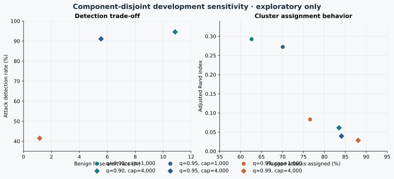

# Exploratory discovery pilot: development partition

**Status:** three exploratory component partitions, a small threshold/cap sensitivity grid on seed 2026, and one assignment-rule ablation; development-only. This is not confirmatory evidence, a final-test result, or evidence of successful poisoning defense.

## Protocol and data boundary

The frozen configuration is `configs/phase3/discovery-development-v1.json`; the exploratory grid is `configs/phase3/discovery-development-sensitivity-v1.json`; the runner is `scripts/run_phase3_discovery_development.py`; corrected raw metrics are in `results/phase3-followup/discovery-development-sensitivity-v2.json`. The evaluator verified the pinned development manifest and hashes before fitting. Every development row ID matched one source-graph row; all 272,506 were assigned to the development role, covering 226,067 components. Component IDs were partitioned 60/20/20 into fit/clustering, benign calibration, and held-out development evaluation. The final-test package was not read.

The autoencoder trained only on benign fit-partition rows (129,753 rows, five epochs, batch size 512). A benign calibration partition (43,043 rows) set the 95th-percentile reconstruction threshold. HDBSCAN received features only from the fit partition; no class labels or poison mask were passed into clustering. Held-out labels were used only after frozen assignments to compute evaluation metrics.

## Observed pilot metrics

| Measure | Result |
|---|---:|
| Attack detection rate | 91.07% (10,386 / 11,405) |
| Attack miss rate | 8.93% |
| Benign false-alert rate | 5.55% |
| Novel candidates assigned to a cluster | 79.13% overall |
| Attack candidates assigned to a cluster | 84.08% |
| Clusters | 102 |
| Assigned-flow cluster purity | 98.58% |
| Adjusted Rand index | 0.0395 |
| Development rows evaluated | 54,767 (11,405 attack; 43,362 benign) |

## Exploratory threshold and candidate-cap sensitivity

The six-cell grid below reuses the same trained autoencoder, component partition, and held-out development labels. It is descriptive and does not select a replacement headline setting.

| Calibration quantile | Candidate cap | Attack detection | Benign false-alert rate | Clusters | Attack cluster coverage | Purity | ARI |
|---:|---:|---:|---:|---:|---:|---:|---:|
| 0.90 | 1,000 | 94.55% | 10.86% | 18 | 62.62% | 98.63% | 0.293 |
| 0.90 | 4,000 | 94.55% | 10.86% | 90 | 83.49% | 98.48% | 0.061 |
| 0.95 | 1,000 | 91.07% | 5.55% | 19 | 70.06% | 96.42% | 0.272 |
| 0.95 | 4,000 | 91.07% | 5.55% | 102 | 84.08% | 98.58% | 0.039 |
| 0.99 | 1,000 | 41.48% | 1.16% | 28 | 76.58% | 95.11% | 0.083 |
| 0.99 | 4,000 | 41.48% | 1.16% | 107 | 88.08% | 97.19% | 0.029 |

Detection and false-alert rates move with the threshold as expected. Increasing the clustering cap changes assignment coverage and ARI materially while leaving threshold-based detection unchanged. The large purity/ARI gap persists across the grid, so high majority-label purity is not a reliable stand-alone claim of family recovery. These six cells share one fit and one evaluation partition; they are not independent replications.

## Interpretation and limitations

The detector flagged most attacks in this partition while producing a 5.55% benign false-alert rate. Cluster purity is high among assigned rows, but ARI is low; the two metrics differ because purity is dominated by each cluster's majority label and ignores unassigned structure, while ARI penalizes broader partition disagreement. Therefore the purity figure alone does not establish meaningful attack-family recovery. The 102 clusters may also reflect fragmentation, and the single component partition/seed gives no estimate of between-seed variation.

This pilot does not measure poisoning persistence, fictitious-label absorption, or downstream continual-learning benefit: no poisoning intervention was applied, and the label-free fit deliberately has no poison metadata. Poison-specific metrics are null (“not measured”), not zero effect. Additional assignment policies and full-method independent-dataset replication remain outstanding. Final-test arrays remain unexported and sealed. The corrected JSON also renames the evaluator's historical `test_*` keys to `eval_*` so these development-only denominators are not mistaken for final-test metrics.

## Frozen assignment-rule ablation

`results/phase3-followup/discovery-development-assignment-summary-v1.json` aggregates paired comparisons across all three partitions; per-partition raw files are listed in that JSON. Each pair uses the same AE, threshold, fitted clusters, and evaluation components. The nearest-centroid variant ignores each cluster's maximum training-member radius.

| Assignment rule | Attack cluster coverage | Novel rows assigned | Purity | ARI |
|---|---:|---:|---:|---:|
| Nearest centroid within training radius | 84.26% +/- 0.89 pp | 10,028 / 12,508 (mean) | 98.70% +/- 0.11 pp | 0.0421 +/- 0.0027 |
| Unrestricted nearest centroid | 100.00% | 12,508 / 12,508 (mean) | 94.82% +/- 0.68 pp | 0.0418 +/- 0.0005 |

Across partitions, unrestricted nearest-centroid assignment raises flagged-attack coverage by 15.74 pp and lowers purity by 3.88 pp. ARI changes by -0.0003 on average. Attack detection and benign false-alert rates are identical within each pair because this ablation changes only assignment after the same frozen novelty decision. This is an exploratory mechanism comparison, not a selection between rules.

## Repeated component partitions

Seeds 2026, 2027 and 2028 produce new component-level fit/calibration/evaluation partitions and new AE initializations. The summary is `results/phase3-followup/discovery-development-replicates-summary-v1.json`; aggregation is reproducible with `scripts/summarize_phase3_discovery_replicates.py` after the three raw runs exist.

| Metric | Mean ± SD across three component partitions |
|---|---:|
| Attack detection | 90.23% ± 2.70 pp |
| Benign false-alert rate | 5.31% ± 0.21 pp |
| Cluster purity | 98.70% ± 0.11 pp |
| Cluster ARI | 0.0421 ± 0.0027 |
| Flagged attacks assigned to a cluster | 84.26% ± 0.89 pp |

These partitions overlap in the source population, so the SD describes sensitivity to the partition/initialization procedure; it is not a confidence interval. The persistent high-purity/low-ARI pattern remains the key interpretation limit.

To reproduce the pilot, run `python scripts/run_phase3_discovery_development.py` from the repository root. The command refuses a changed development manifest or source-ID mapping and writes only under `results/phase3-followup/`.
