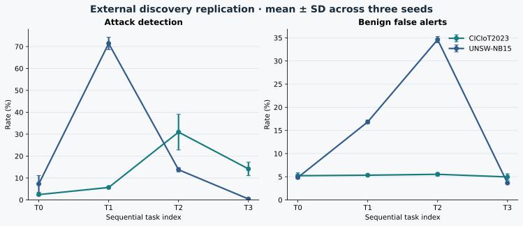

# External dataset readiness audit

**Decision:** direct UNSW↔CICIoT feature transfer is not defined. A three-seed independent replication of the label-free discovery submodule has now run on the corrected task artifacts. The full poisoning/continual-learning estimand remains unreplicated externally.

## Audited data interfaces

| Dataset | Inputs | Labels | Task schedule | Existing train/test convention |
|---|---:|---:|---|---|
| UNSW-NB15 | 194 | 10 | 4 CII tasks; Normal sliced across tasks, attacks assigned by source row order | Provider train/test pools are preserved; the mirror filenames were swapped and the loader compensates |
| CICIoT2023 | 39 | 8 | 4 CII tasks; benign quotas and attack classes capped | Source train/test pools are retained; deterministic capped sampling |
| Adopted CICIDS2017 reference | 74 | 16 taxonomy entries (one test-only) | 4 staged training arrivals; 5 simulated owners | Canonical-component grouped train/development/test roles; prepared test rows are withheld |

The UNSW and IoT input names have zero intersection. Their feature-unit metadata marks every field as undocumented. Matching class names such as DoS do not make inputs, attack definitions, acquisition mechanisms, task timing, or test estimands equivalent. No safe common-feature projection can be inferred from these sidecars.

## Existing mirror results are invalid for citation

`results/_archive/label_fix_20260928/manifest.json` explicitly marks the archive as superseded: pre-fix UNSW used benign ID 7, and IoT used benign ID 1 while target ID 0 was unmapped. This is direct provenance evidence that old mirror metrics must not be presented as external validation. The corrected `tasks_unsw.json` and `tasks_iot.json` identify benign as class 0, but corrected labels alone do not repair the protocol mismatch with the adopted CICIDS study.

## What can be claimed now

- **Direct transfer:** blocked pending a source-reviewed semantic mapping, compatible transformations/units, and a train-on-one/evaluate-on-the-other protocol.
- **Independent refits:** feasible as a descriptive extension after a new protocol is frozen. Each dataset needs a separately fitted scaler/model, its own label and task schedule, matched outcome definitions, and new paired runs. Report effects separately; do not pool them.
- **Replication of poisoning persistence/acquisition:** the new method extension adapts FT/EI/DR/DR+DC to native input widths and the external task schedule with synthetic clients. It is a train-only pilot of an independent benchmark extension, not a faithful replication of the adopted CICIDS estimand.
- **Generalization limits:** UNSW tasks use source row order as an ordering proxy; CICIoT uses capped sampling. Neither metadata package records component/session groups comparable to the adopted CICIDS component split. Any external result must disclose this weaker isolation.

## External discovery pilot results

The frozen submodule protocol is `configs/phase3/external-discovery-replication-v1.json`; runner: `scripts/run_phase3_external_discovery.py`; corrected raw output: `results/phase3-followup/external-discovery-v2.json`; aggregation code and results: `scripts/summarize_phase3_external_discovery.py` and `results/phase3-followup/external-discovery-summary-v2.json`. Three model/calibration seeds (1, 42, 101) were run for four task splits in each dataset. Each dataset got an independent autoencoder, threshold, and clustering fit. Benign calibration rows were excluded from cluster fitting. No features/weights transferred between datasets.

| Dataset | Equal-task attack detection | Equal-task benign false-alert rate | Equal-task cluster ARI |
|---|---:|---:|---:|
| CICIoT2023 | 13.30% ± 2.38 pp | 5.26% ± 0.18 pp | 0.162 ± 0.009 |
| UNSW-NB15 | 23.22% ± 1.46 pp | 14.98% ± 0.17 pp | 0.083 ± 0.008 |

Values are means across four task-specific rates; uncertainty shown is sample SD across the three seeds. No flow counts are pooled across seeds, and datasets are not pooled. These low detection rates and task variation do not support a useful standalone external detector under the frozen threshold. They are an adverse exploratory result for this submodule, not a comparison of the complete Phase 3 defense. Do not compare the raw reconstruction thresholds across datasets: feature units are undocumented and feature dimensions differ.

The earlier `external-discovery-v1*.json` outputs are superseded because benign calibration rows were inadvertently included in clustering. The corrected v2 runner excludes them; only v2 outputs above should be cited.

## Gate before training

Prepare a versioned external protocol that (1) chooses the external estimand and matched phases, (2) names a feasible attack/target pair in each dataset, (3) specifies how persistent ownership and poisoning withdrawal are represented, (4) freezes metrics/seed pairing, and (5) audits duplicates/session isolation where provenance permits. If these conditions cannot be matched without changing the research question, call the work an independent benchmark extension, not replication of the primary claim.

## Prospective full-method extension feasibility

Two narrow audits now support a draft, dataset-specific simulated-client extension; they do not support a faithful replication claim. The train-label-only support audit selects `Exploits` for UNSW-NB15 (33,393 task-1 training rows) and `DoS` for CICIoT2023 (12,000 rows), using a predeclared maximum-support rule among attack classes first appearing in task 1. It does not inspect test labels or features. The ID-only audit finds no row-ID reuse across tasks within either provider train pool or test pool. These pool-local positional IDs cannot identify duplicates between train and test or establish sessions/components.

The protocol is `configs/phase3/external-method-extension-v1.json`; its design, train-only pilot and gates are in `external-method-extension-v1.md`. It uses separate feature dimensions, original dataset-specific tasks and T0-fitted transforms, and explicitly synthetic persistent clients. A one-seed paired pilot completed 16 training arms and saved 64 task-stage checkpoints. Its inventory is `results/phase3-followup/external-method-training-pilot-summary-v1.json`. It computed no test metrics; extension test scoring remains gated.

## Full-method compatibility audit

A read-only, machine-readable audit is available at `results/phase3-followup/external-full-method-compatibility-v1.json`, generated by `scripts/audit_phase3_external_compatibility.py`. It checks the frozen 74-input reference contract against the corrected UNSW and CICIoT task sidecars, including feature counts and names, label maps, task sizes, owner/group metadata, and artifact hashes. It does not load feature or label arrays and records `final_test_accessed: false`.

The audit identifies five blockers to claiming a faithful external replication: fixed 74-feature model interfaces versus 194/39 external inputs; absent persistent owner assignments; absent comparable component/session grouping; differing task taxonomies without a prespecified map; and undocumented feature units. The external discovery submodule remains a separate exploratory refit. The new external method runner exercises a versioned simulated-client adaptation, but cannot resolve the provenance or comparability limitations; it is not evidence of held-out performance.
