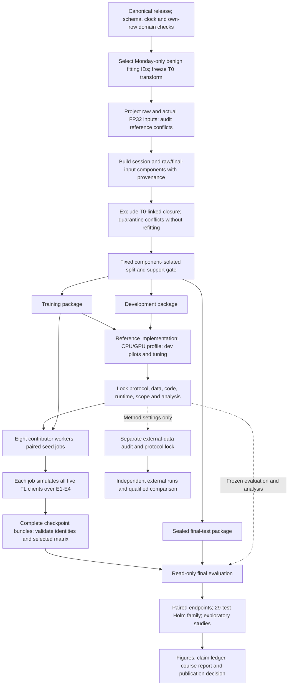
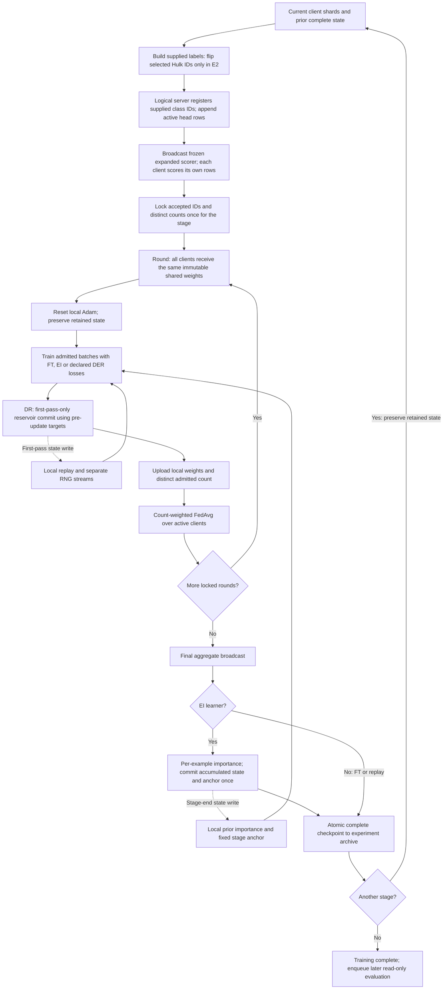

# Methodology diagram review and Phase 3 architecture

Visual review performed on the current Phase 2 PDF's pages 20–21, 24 October 2026. This review supports the Phase 3 plan; the existing manuscript/diagrams have not been edited in this planning pass.

## 1. What the reviewed diagrams already communicate correctly

- Train/development/test and T0 roles are distinct.
- Development precedes a protocol lock; test outputs have no return arrow to learning.
- Corruption happens before class registration/admission and is limited to E2 training labels.
- Head expansion/admission happen once per stage; optimizer reset happens each round.
- Replay read/write and EI's stage-end importance commitment are separate.
- E3/E4 stop fresh corruption but can retain poisoned state.

The page layouts are legible at normal page scale, with distinct boxes and crossing gaps. No clipped box text was observed in the inspected rendering. This is visual review, not an implementation conformance test.

## 2. Clarifications for the implementation diagram

| Ambiguity | Phase 3 clarification |
|---|---|
| The one-stage figure does not draw the next-stage transition explicitly | Show complete state carried to the next stage and final evaluation only after the locked selected matrix is ready |
| “Server registry + admission” can imply central raw-data scoring | The logical server broadcasts the expanded scorer; admission scores remain client-local and only declared model/count/registry messages reach the logical FL server |
| Research checkpoints include local state | Distinguish the experiment controller/archive from the logical FedAvg server; the simulator physically has all data and provides no deployed privacy guarantee |
| Eight accounts might be mistaken for eight FL clients | Each compute worker runs an independent five-client simulation; workers are parallel experiment resources |
| Final testing may appear to follow whichever run finishes first | Gate final evaluation on the complete locked selected matrix and valid artifacts; no test-driven scope or hyperparameter changes |
| Analysis settings are described but their lock is less visible | Connect the frozen analysis specification to evaluation/analysis explicitly |
| Optional external data appears to inherit a complete protocol | It needs its own release/schema/split/source/stage audit and protocol lock; only method settings transfer |
| Snapshot loss and head growth can be conflated | Create the new active head first, then freeze the scorer, then lock accepted IDs for the stage |

## 3. Study workflow



The transform is applied to every split without refitting. No arrow carries a final outcome back to scope selection, tuning or training. The optional external branch is not a pooled estimator.

## 4. Stage and round lifecycle



The archive is controlled by the research simulator. It is not a new raw-data message to the logical FedAvg server. Local replay/importance branches are method-specific; FT uses neither. Registry state is append-only, and all active rows remain trainable. The controller must preserve local state and RNG even though model weights are replaced by broadcasts.

## 5. One replay update: order matters

```text
Read admitted current batch.
Cache pre-update eval-mode current logits when first-pass insertion requires them.
Draw min(128, occupancy) from the existing buffer without replacement.
Compute current CE and replay CE with training dropout.
Compute masked/width-normalized replay MSE with dropout off and gradients enabled.
Average each term separately; update local weights once.
Commit eligible first-pass records through Algorithm R using the pre-update cache.
Continue with the saved cursor and independent RNG states.
```

Evaluation mode does not disable gradients. `no_grad` is appropriate for cached teachers; it is not appropriate for the replay MSE student forward. Replaying before insertion prevents a new current record from becoming its own same-update replay example.

The diagrams are native editable specifications. When producing final report figures, render them as vector diagrams with a readable minimum font and verify the exported pages again.
