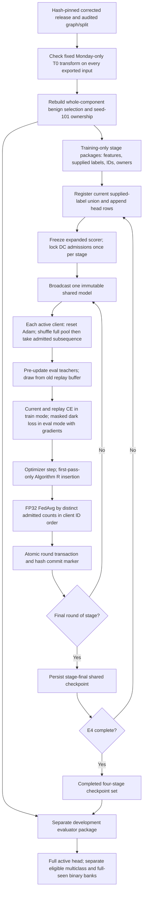

# Phase 3 reference: adopted data and resolved taxonomy

The current implementation contract is [reference74-v1.json](../../configs/phase3/reference74-v1.json).
Its exact byte identity is pinned by the reference executable. Changes need a
new version. The [adoption record](adoption.json) links the prior data-only audit
to the user-authorized decision. The [submission amendment](../../submissions/phase3-methodology-amendment.md)
supersedes the original proposal's 76-input/15-output assumptions for Phase 3.

## What runs

One **clean DR+DC development reference**, seed 101, all 183,045 selected training
records, five simulated clients, four stages, three communication rounds and one
epoch per round. Learning rate .001, lambda_y=1, lambda_z=.5; these are untuned
implementation settings. No GPU grid or final-test evaluation is authorized by
this configuration. The CLI accepts only this immutable reference protocol.

| Stage | Fresh rows | Head width | New attack annotations |
|---|---:|---:|---|
| E1 | 7,658 | 3 | FTP-Patator, SSH-Patator |
| E2 | 106,239 | 8 | GoldenEye, Hulk, Slowhttptest, Slowloris, Heartbleed |
| E3 | 7,178 | 13 | Infiltration, Infiltration - Portscan, three web annotations |
| E4 | 61,970 | 16 | Bot, DDoS, PortScan |

Each fresh pool contains 3,500 benign records before admission. The full
[taxonomy/support table](../../configs/phase3/taxonomy-v1.json) distinguishes
annotation codes from classifier slots and scoring eligibility. The two scan
labels denote distinct capture scenarios; the study concerns acquisition of
new annotations, without assuming new underlying techniques.

## Executable data and state flow



The implementation hashes and exports the existing audited graph/split. It
independently rebuilds benign selection and ownership and checks the frozen
transform on every exported training/development row. It does **not** claim a new
from-CSV reconstruction of the session graph. The source archive, cache files,
upstream reconstruction reports and exact split-reuse proof remain hash-linked.

## Reproduce locally

Run from the repository root. A dedicated Windows CPython 3.12.14 environment is
used. The CPU wheel follows the [official PyTorch installation route](https://pytorch.org/get-started/locally/);
this lock is separate from any future Kaggle CUDA runtime.

```powershell
python -m venv .venv-phase3-reference
.venv-phase3-reference\Scripts\python.exe -m pip install -r configs/phase3/requirements-reference-cpu.lock --extra-index-url https://download.pytorch.org/whl/cpu

# Requires the locally acquired/audited source assets; refuses to overwrite.
.venv-phase3-reference\Scripts\python.exe -m src.phase3.prepare --output data/processed/phase3-reference74-v1

# Training receives only the train directory, without dev/test arrays.
.venv-phase3-reference\Scripts\python.exe -m src.phase3.reference --train-package data/processed/phase3-reference74-v1/train --output results/phase3-reference74-v1/reference

# Fresh process restores a committed early round and re-executes the suffix.
.venv-phase3-reference\Scripts\python.exe -m src.phase3.reference --train-package data/processed/phase3-reference74-v1/train --resume results/phase3-reference74-v1/reference/E1-R2.npz --output results/phase3-reference74-v1/recovered

.venv-phase3-reference\Scripts\python.exe -m src.phase3.accept_reference --run results/phase3-reference74-v1/reference --recovered results/phase3-reference74-v1/recovered --output results/phase3-reference74-v1/acceptance.json

# Separate read-only development evaluator; no final-test path is accepted.
.venv-phase3-reference\Scripts\python.exe -m src.phase3.evaluate --development-package data/processed/phase3-reference74-v1/development --run results/phase3-reference74-v1/reference --output results/phase3-reference74-v1/development-evaluation
```

Existing output directories are immutable. Choose fresh destinations when
reproducing locally; hashes distinguish repetitions and scientific identities.
The development evaluator supports a complete from-start reference output, not
an incomplete suffix directory without its earlier stage checkpoints.

## Review evidence and limits

The executed summary is recorded in [reference-report.md](reference-report.md).
Large arrays/checkpoints are local derived artifacts. Small adoption, preparation,
acceptance, runtime and count reports are copied into this directory for review.
No raw-data archive is redistributed by this documentation.

One early implementation attempt shuffled the accepted pool directly. It was
superseded before any evaluation because the paired-arm convention requires a
full-pool permutation followed by its accepted subsequence. Its invalidation
record and exact source snapshot remain in
`results/phase3-reference74-v1/full/`; those checkpoints are not paper evidence.

Round-boundary recovery re-executes an interrupted round in full. It does not
promise mid-batch resume or protection from loss of all local files. No live
optimizer exists at the committed boundary because Adam resets before the next
broadcast. The persistent client dropout and replay streams are saved exactly;
all stochastic model operations use explicit scoped RNG contexts.

Before GPU dispatch: implement/accept the other learners and matched controls,
controlled corruption, EI arithmetic and interventions; confirm a pinned GPU
runtime; profile complete workloads; run clean development pilots/tuning;
freeze the selected experiment scope and analysis. The original planning grid
remains non-dispatchable. CPU reference timing is not a GPU quota estimate.
