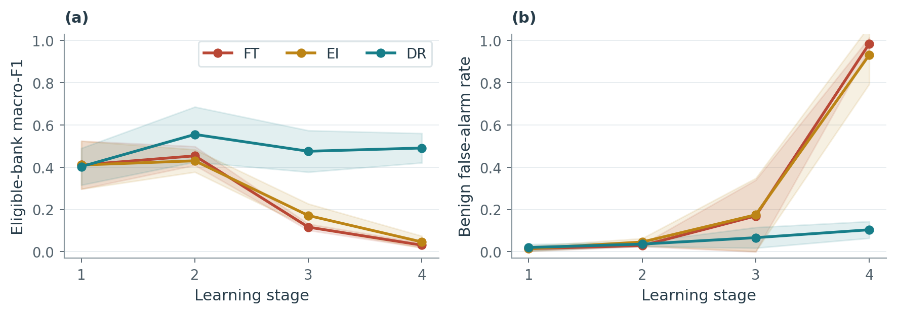
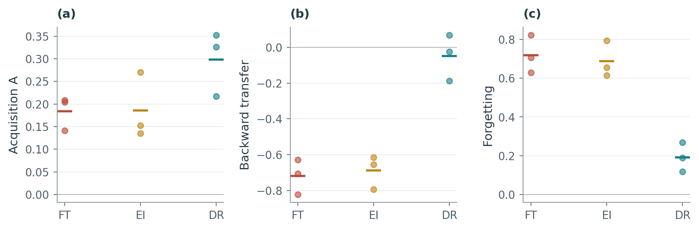
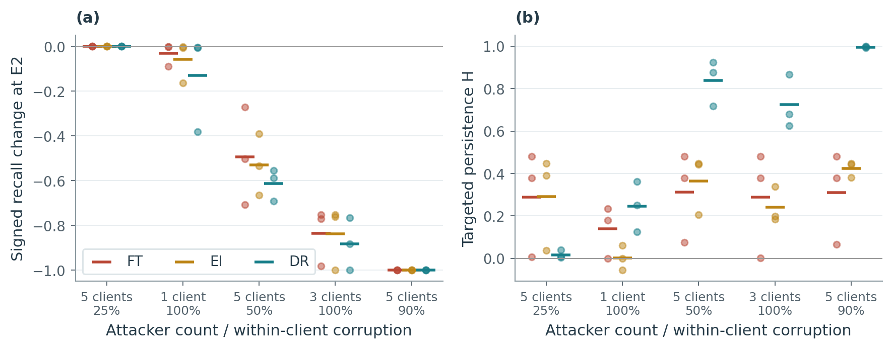
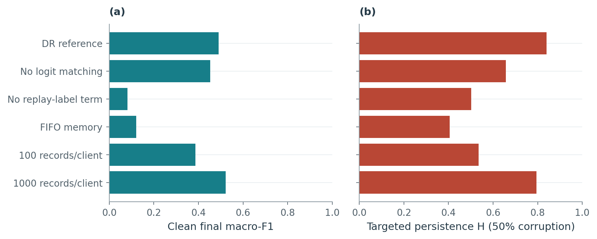
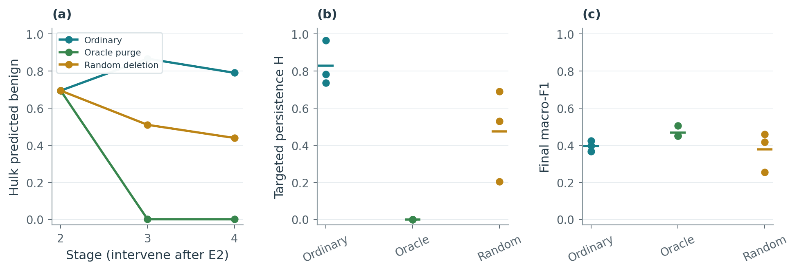
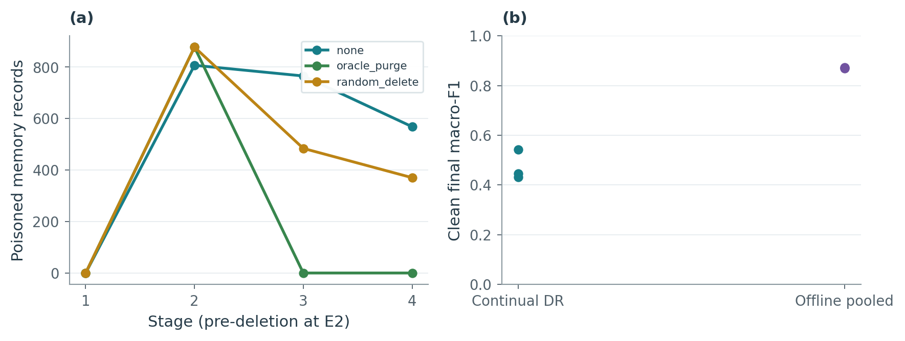
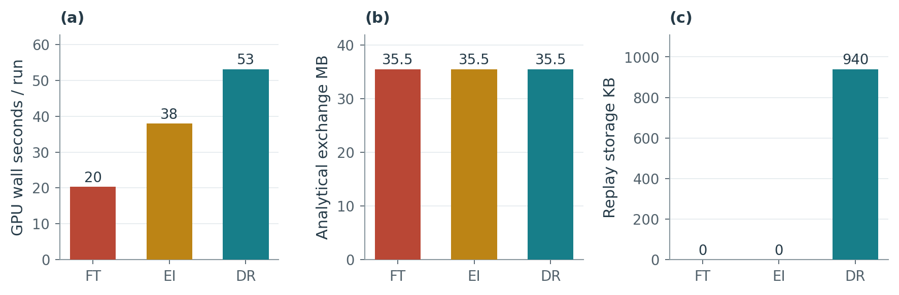

# Poisoning persistence and legitimate adaptation in federated continual intrusion detection

Saneedullah (23I-2568) and Ahmed Bilal (23I-2581) | Computer Networks, Phase 3 | 15 November 2026

## Abstract

We implement a five-client federated class-incremental intrusion detector and investigate training-label corruption during acquisition of a new attack family. The main development-bank study contains 696 GPU trajectories across three ownership partitions and four training replicates per partition. A further 21 full-budget CPU trajectories provide a separate completed evaluation of post-attack replay-memory interventions. Additional controls are included below only when completed and validated. DER++-style replay attains clean final eligible macro-F1 0.491, while fine-tuning and the EWC-style variant largely forget earlier classes. The attack produces targeted errors after withdrawal; class protection preserves admission counts without guaranteeing effective acquisition. With identical pre-intervention E2 state, CPU oracle removal of known poisoned replay yields mean targeted persistence H=0.000, versus 0.474 after count-matched random deletion. The oracle is a diagnostic intervention, not a deployable defense. Findings are conditional on one corrected CICIDS2017 split; no final-test or independent-site generalization is claimed.

## 1. Research questions and contribution

An intrusion detector must learn newly annotated attack families while retaining older ones. Federated learning adds heterogeneous ownership, and replay can retain both useful examples and corrupted labels. RQ1 asks how learning mechanisms differ in immediate source-family damage and persistence after attacker withdrawal. RQ2 asks whether class-aware admission improves the trade-off between targeted error and legitimate acquisition. RQ3 asks which replay and selection mechanisms explain these effects. The contribution is a controlled empirical study with explicit failure cases, rather than a claim of a generally successful defense or exhaustive novelty.

### 1.1 Phase 2 to Phase 3 changes

| Item | Implemented decision and consequence |
| --- | --- |
| Data / inputs | Corrected CICIDS2017; 74 numeric inputs; source taxonomy retained as 16 classes. |
| Reduced scope | One capture and one source-to-benign corruption pattern. Cross-dataset transfer and unsupervised discovery were not executed. |
| Attacker grid | Added 1-, 3-, and 5-client arms after weak earlier effects; expanded arms are exploratory. |
| Replications | Three ownership partitions x four training replicates; these are not 12 independent partitions or captures. |
| Persistence | Restored Phase 2 H: mean E3/E4 targeted-ASR increase. Final recall damage remains a separate diagnostic. |
| Immediate damage | Poisoned-minus-clean E2 recall; negative values indicate harm, matching Phase 2. |
| Statistics | 47 amended GPU contrasts use one combined Holm sensitivity correction; this does not recreate the planned 29-test confirmatory study. |
| CPU extension | 21 separate CPU trajectories; replay intervention uses 1 replicate(s) per partition. |
| Feedback | No specific instructor feedback was supplied. Scope decisions are author decisions; instructor approval is not asserted. |

## 2. Dataset, preprocessing and isolation

The source is the corrected release associated with Liu et al. [6], pinned by SHA-256. That work documents errors in orchestration, feature generation and labels; using its corrected release does not make the historical capture an independent modern dataset. Attempted-category remapping is applied under the adopted annotation policy before conflict handling. Invalid/nonfinite features are excluded under the named preparation policy; forward and backward header-length totals are omitted. A Monday-benign-only min/max transform is frozen before later stages, with zero-range denominator one and no clipping or later refit. This is an ordered annotated-class benchmark, not evidence of live zero-day discovery.

Sessions linked within the declared 120-second interval and exact-content links form indivisible connected components. The fixed grouped five-fold split assigns folds 2/3/4 to training, fold 1 to development, and fold 0 to final test. Persistent whole-component ownership assigns five simulated clients using family-skew targets. Components do not cross the declared roles; this does not demonstrate host, campaign, or site independence. No final-test path is read by the supplement. Fresh checks find 183,045 unique training IDs per partition, 272,506 development rows, and zero training/development ID intersections. These ID checks supplement, rather than replace, the prior content/component preparation audit.

### 2.1 Class inventory and scoring support

| Annotation | Stage | Train | Development | Headline |
| --- | --- | --- | --- | --- |
| Benign | 1 | 14000 | 216158 | Eligible |
| Bot | 4 | 441 | 148 | Eligible |
| DDoS | 4 | 57086 | 19029 | Eligible |
| DoS GoldenEye | 2 | 4540 | 1513 | Eligible |
| DoS Hulk | 2 | 95080 | 31694 | Eligible |
| DoS Slowhttptest | 2 | 1037 | 346 | Eligible |
| DoS Slowloris | 2 | 2071 | 691 | Eligible |
| FTP-Patator | 1 | 2382 | 795 | Eligible |
| Heartbleed | 2 | 11 | 0 | Descriptive |
| Infiltration | 3 | 27 | 5 | Descriptive |
| Infiltration - Portscan | 3 | 3591 | 1198 | Eligible |
| PortScan | 4 | 943 | 315 | Eligible |
| SSH-Patator | 1 | 1776 | 592 | Eligible |
| Web Attack Brute Force | 3 | 43 | 15 | Descriptive |
| Web Attack Sql Injection | 3 | 7 | 3 | Descriptive |
| Web Attack XSS | 3 | 10 | 4 | Descriptive |

All supported annotation classes remain trainable and their logits remain active. The fixed scoring-support floor requires at least 50 rows and five components per role. Heartbleed has no development positives; ordinary Infiltration and web classes are descriptive. Full-inventory confusion matrices remain in raw run files. Headline macro-F1 is explicitly restricted to eligible classes, and must not be described as performance on every source annotation.

## 3. Implemented methodology

The shared classifier is an MLP with 74 inputs, hidden widths 128 and 64, ReLU and dropout 0.1. Output slots are append-only and expand 3 -> 8 -> 13 -> 16. Raw source codes and output-slot indices are distinct. Five clients train locally and the server performs current-admitted-row-weighted FedAvg [5]. Ownership persists across stages. At every broadcast Adam is reset, so optimizer state is not silently carried between server rounds.

| Setting | Value |
| --- | --- |
| Rounds / local epochs | 12 per stage / 1 per round |
| Learning rate / batch | 0.001 / 256 |
| DR replay | 500 records/client; replay batch at most 128 |
| DR objective | Current CE + 1.0 replay-label CE + 0.1 historical-logit MSE |
| Historical logits | Pre-update, evaluation-mode teachers; mask to stored head width |
| Memory | First-pass reservoir proposals; distinct stage records inserted once |
| EI importance | Per-example diagonal Fisher, accumulated across stages; penalty weight 100 |
| Main GPU runtime | Tesla T4; Python 3.13.16; torch 2.11.0+cu130; NumPy 2.1.3; four workers |
| CPU supplement | Intel64 Family 6 Model 142 Stepping 12, GenuineIntel; Python 3.14.0; torch 2.14.0+cpu; NumPy 2.4.3; one worker/thread |

FT uses only current-stage cross-entropy. EI adds an EWC-style [4] parameter-importance penalty anchored to the previous shared model, with zero importance for new head rows. DR combines current data with client-local stored inputs, supplied labels, and historical logits [3]. First-pass reservoir proposals follow Algorithm R [8]; the declared post-deletion vacancy rule is a separate intervention convention. Both replay terms share a sampled batch in this implementation. This is a declared DER++-style adaptation, not a faithful reproduction of the original visual benchmark implementation. EWC-style naming similarly preserves the distinction between this Fisher/anchor implementation and every EWC variant.

$$\mathcal{L}_{\mathrm{DR}}=\mathrm{CE}(f_\theta(x),\widetilde y)+\lambda_y\,\mathrm{CE}(f_\theta(x_r),\widetilde y_r)+\lambda_z\,\mathrm{MSE}_{\mathrm{old}}(f_\theta(x_r),z_r),\qquad \theta^{+}=\sum_k\frac{n_k^{\mathrm{adm}}}{\sum_j n_j^{\mathrm{adm}}}\theta_k.$$

Here supplied labels may be corrupted; the logit term averages only over coordinates present at storage time. Replay does not access evaluator labels. The aggregation equation uses admitted current-row counts and is held fixed across the volume-matched admission controls.

### 3.1 Threat and admission controls

In E2, seeded nested subsets of DoS Hulk records on selected clients are relabelled benign. Training and admission see supplied labels only. E3/E4 receive no new corruption; historical poison may survive. Attack arms vary both client count and within-client dose, and global flipped fractions depend on ownership. A one-client arm cannot be interpreted as interchangeable with an equal-size five-client corruption. The threat assumes compliant training agents; it does not cover arbitrary forged updates, server compromise, or an adaptive filter-aware adversary.

At each stage, the frozen expanded model scores admission before training. DC admits all new-labelled and small classes and retains the lowest-loss rows within other per-class quotas (default fraction 0.75, small-class threshold 20). DM uses global loss ranking with exactly the same per-client volume and aggregation weight. DQ uses DC's class quotas but selects randomly within class. NONE admits all rows. Poisoned Hulk rows bear supplied benign labels and therefore do not receive new-class protection. Retaining all honestly new-labelled rows is a construction check, not proof of learning.

### 3.2 Executed experiment matrix

| Evidence block | Fixed matrix | Trajectories |
| --- | --- | --- |
| GPU learners | FT/EI/DR x six clean/attack arms x 12 paired units | 216 |
| GPU admission | DC/DM/DQ on DR x six arms x 12 paired units | 216 |
| GPU component changes | 11 changed settings x own clean/poisoned twins x 12 units | 264 |
| CPU mechanism | Four clean/ordinary/oracle/random conditions x three partitions x 1 replicate(s) | 12 |
| CPU DQ | Own clean/poisoned twin x three partitions; replicate 0 | 6 |
| CPU pooled | Three initializations of the same full training inventory | 3 |

| GPU attack arm | Mean global Hulk corruption | Minimum / maximum |
| --- | --- | --- |
| k5-d0.25 | 25.0% | 25.0% / 25.0% |
| k1-d1 | 25.7% | 5.9% / 50.4% |
| k5-d0.5 | 50.0% | 50.0% / 50.0% |
| k3-d1 | 70.3% | 37.1% / 91.8% |
| k5-d0.9 | 90.0% | 90.0% / 90.0% |

Arm kN-dX means N attacking clients each corrupt fraction X of their own Hulk rows. Realized global exposure varies by ownership and corruption replicate. No unmatched global DG arm, external CICIoT2023 evaluation, or final-test inference is claimed. The new CPU intervention directly addresses the earlier missing replay-memory diagnostic within a restricted oracle-access design.

## 4. Metrics, evaluation population and inference

| Measure | Definition / interpretation |
| --- | --- |
| ASR(t) | Hulk rows predicted benign / all fixed Hulk-bank rows; untriggered targeted error. |
| Persistence H | Mean over E3 and E4 of poisoned ASR minus matched clean ASR; higher is worse. |
| Immediate recall change | Poisoned E2 Hulk recall minus matched clean recall; lower is worse. |
| Final recall damage | Clean minus poisoned E4 Hulk recall; includes errors into other attack labels. |
| Acquisition A | Average per-stage F1 of eligible newly introduced families excluding Hulk, then equal average over E2-E4. |
| FAR | Benign rows predicted any attack / benign rows. |
| BWT / forgetting | Cohort-recall backward transfer and maximum previous recall minus final recall, as implemented in the archived summary. |

$$\mathrm{ASR}_t=\frac{C_t[\mathrm{Hulk},\mathrm{Benign}]}{\sum_c C_t[\mathrm{Hulk},c]},\qquad H=\frac12\sum_{t=3}^{4}(\mathrm{ASR}^{\mathrm{poison}}_t-\mathrm{ASR}^{\mathrm{clean}}_t).$$

The independent confusion-matrix audit verifies archived accuracy, benign FAR, Hulk recall and targeted ASR. The older scorer averaged eligible-class F1 while retaining unsupported true-class rows in false-positive counts. The corrected scorer restricts true rows to the eligible bank but retains every active prediction column: predicting an unsupported class still counts as an error. The maximum absolute macro-F1 change across all 696 trajectories/stages is 0.001342. Both versions and denominators are preserved in metric-population-audit.csv. Acquisition is recomputed on the same corrected population.

Every attack outcome uses the clean twin with identical learner, admission, component ownership, replicate and variant. GPU and CPU comparisons are kept separate. Within a fixed ownership partition, the replicate index changes model, minibatch, poisoning and replay random streams; it is not solely optimizer noise. For paired sensitivity analyses, these replicates are averaged within each ownership partition. Three partition-level effects are shown directly; conditional signed-rank sign enumeration handles zeros and average-rank ties explicitly. It assumes symmetric differences and exchangeable signs and does not create independent captures. All-zero effects have p=1 and undefined rank-biserial effect. Combined Holm correction [9] covers 47 amended GPU contrasts, with a separate declared family of 15 CPU mechanism contrasts. With only three partition units, two-sided exact sign enumeration cannot produce p<0.05. Nonsignificance is not equivalence, immunity, or evidence of no mechanism. No narrow bootstrap confidence claim is made from three partitions.

## 5. Clean baselines and poisoning results

| GPU learner | Final F1 (SD) | Accuracy | FAR | Acquisition |
| --- | --- | --- | --- | --- |
| FT | 0.031 (0.012) | 0.084 | 0.984 | 0.184 |
| EI | 0.046 (0.028) | 0.125 | 0.932 | 0.186 |
| DR | 0.491 (0.070) | 0.911 | 0.104 | 0.299 |

| GPU learner | Macro precision (SD) | Macro recall (SD) |
| --- | --- | --- |
| FT | 0.047 (0.043) | 0.241 (0.038) |
| EI | 0.098 (0.083) | 0.200 (0.039) |
| DR | 0.451 (0.069) | 0.717 (0.070) |

| GPU binary detector | Accuracy | TPR | FPR | Precision | F1 |
| --- | --- | --- | --- | --- | --- |
| FT | 0.219 | 0.999 | 0.984 | 0.209 | 0.346 |
| EI | 0.261 | 0.998 | 0.932 | 0.222 | 0.362 |
| DR | 0.916 | 0.993 | 0.104 | 0.721 | 0.834 |

The DR benign FAR corresponds to about 1038 false alerts per 10,000 benchmark benign flows. This is a fixed-bank reporting unit, not a daily deployment forecast; traffic prevalence and operating volume were not measured. Good relative retention therefore does not establish deployment readiness.

Binary detection treats every non-benign prediction as an alert. Very high TPR can coexist with unusable false-alarm rates, as the FT/EI rows show. Precision depends on the bank's class prevalence. For macro precision only, a supported but never-predicted class contributes zero; its undefined-precision flag remains in the per-family CSV. Macro-F1 is computed directly from confusion counts, not from the macro-averaged precision and recall.


| Clean learner | E1 FTP recall | E1 SSH recall | E4 FTP recall | E4 SSH recall |
| --- | --- | --- | --- | --- |
| FT | 0.667 | 0.083 | 0.000 | 0.000 |
| EI | 0.667 | 0.083 | 0.000 | 0.000 |
| DR | 0.667 | 0.167 | 0.583 | 0.664 |

Clean viability is imperfect even at the first stage, particularly for SSH-Patator. Therefore final collapse is not attributed exclusively to forgetting: acquisition, class imbalance, optimization and federation can also contribute. This limits how strongly the learner comparison can generalize. The offline pooled reference below checks learnability under different historical access; it does not repair or tune these baselines after observing the attack results.

FT and EI largely forget earlier families even without poisoning. Their zero additional final Hulk recall loss is a floor effect, not a robustness result. DR retains more earlier-class knowledge, but this creates more retained capability for poisoning to damage. Accordingly, absolute targeted errors, immediate damage and clean capability are reported together.







### 5.1 Admission trade-offs

| DR rule | H, 50% | F1, 50% | A, 50% | H, 90% | A, 90% |
| --- | --- | --- | --- | --- | --- |
| NONE | 0.839 | 0.427 | 0.298 | 0.996 | 0.299 |
| DC | 0.607 | 0.325 | 0.192 | 0.990 | 0.175 |
| DM | 0.678 | 0.444 | 0.275 | 0.996 | 0.140 |
| DQ | 0.282 | 0.451 | 0.258 | 0.996 | 0.269 |

| DR rule, 50% arm | Poison admitted | New-labelled retained | Final poisoned slots |
| --- | --- | --- | --- |
| NONE | 1.000 | 1.000 | 630.0 |
| DC | 0.792 | 1.000 | 542.2 |
| DM | 1.000 | 0.769 | 672.2 |
| DQ | 0.750 | 1.000 | 515.2 |

These diagnostics distinguish selection from learning. At moderate corruption, DC admits fewer poisoned records than the global ranking but can still learn legitimate families less effectively. DQ is a volume/class-quota control with different record selection; it must be compared on held-out outcomes as well as admitted counts. Poisoned memory totals are slots across all five clients.

The moderate and severe arms must be distinguished. Random class-aware selection is competitive in the saved moderate arm, so the earlier blanket statement that no rule reduces damage was too broad. At severe corruption, protecting new-class row counts does not prevent large attack effects. DC can reduce acquisition relative to either a volume-matched ranking or random control. The relationship between class quotas, ranking and held-out discrimination is therefore a measured trade-off rather than a successful-defense claim.


## 6. Component ablations

| Replay variant | Clean F1 | Attacked F1 | H | A |
| --- | --- | --- | --- | --- |
| DR reference | 0.491 | 0.427 | 0.839 | 0.298 |
| No logit matching | 0.453 | 0.401 | 0.657 | 0.270 |
| No replay-label term | 0.083 | 0.055 | 0.503 | 0.189 |
| FIFO memory | 0.121 | 0.056 | 0.406 | 0.204 |
| 100 records/client | 0.386 | 0.344 | 0.535 | 0.263 |
| 1000 records/client | 0.522 | 0.471 | 0.794 | 0.301 |
| DR+DC reference | 0.403 | 0.325 | 0.607 | 0.192 |
| DC quota 0.5 | 0.396 | 0.292 | 0.427 | 0.168 |
| DC quota 0.9 | 0.457 | 0.336 | 0.751 | 0.205 |
| DC small-class threshold 5 | 0.403 | 0.325 | 0.607 | 0.192 |
| DC small-class threshold 100 | 0.406 | 0.325 | 0.607 | 0.192 |
| EI reference | 0.046 | 0.036 | 0.365 | 0.185 |
| EI penalty 10 | 0.074 | 0.033 | 0.284 | 0.198 |
| EI penalty 1000 | 0.040 | 0.036 | 0.431 | 0.160 |

Each changed learner has its own clean twin. Removing the replay-label term and replacing reservoir memory with FIFO can substantially reduce ordinary retention. A small final recall-damage value in those conditions cannot establish protection. The label-only replay arm (no logit matching) already supplies an experience-replay comparison. Capacity changes alter useful and corrupted memory simultaneously. The archived additional quota and Fisher-strength ablations are exploratory; nearly identical nmin variants do not establish insensitivity unless their class-count thresholds were actually crossed.



## 7. New CPU mechanism and learnability experiments

The supplement completed 21 full-budget CPU trajectories. The main four-condition mechanism experiment uses three ownership partitions x 1 training replicate(s). DQ and offline pooled checks are reported only when all their planned runs have completed; they are otherwise pending and excluded from numerical claims. All comparisons within the supplement use CPU clean references and the same current source/input identity. The runtime and source manifests identify exact software versions, files, configurations and SHA-256 values; each completed result is written atomically and validated before reuse.

At five attackers and 50% E2 corruption, ordinary replay, oracle deletion and count-matched random deletion begin from identical end-E2 model parameters, buffer tensors, labels, logits, poison flags and RNG states. State fingerprints and E1/E2 metrics must match exactly or the run is rejected. The oracle deletes evaluator-marked poisoned records; random deletion removes the same number per client using an intervention-only RNG. Both compact all buffer fields, preserve historical proposal counts and refill vacancies on subsequent insertions. This is a memory-content intervention with declared sampling consequences, not standard reservoir sampling of the entire original history after deletion. No new poison is introduced during E3/E4.

| CPU condition | Runs | H | Final F1 | FAR | A |
| --- | --- | --- | --- | --- | --- |
| Clean DR | 3 | 0.000 | 0.473 | 0.122 | 0.306 |
| Poisoned / ordinary | 3 | 0.828 | 0.395 | 0.133 | 0.288 |
| Poisoned / oracle purge | 3 | 0.000 | 0.468 | 0.227 | 0.291 |
| Poisoned / random deletion | 3 | 0.474 | 0.377 | 0.254 | 0.289 |

For the most direct mechanism contrast, oracle-minus-random H differences by ownership partition are seed 101: -0.689, seed 102: -0.528, seed 103: -0.204. Negative values favor oracle deletion. This comparison tests the contribution of continuing stored poison relative to a count-matched memory-content change. It does not remove damage already present in E2 weights, hold later replay draws identical after composition changes, or establish a deployable purification method. Random deletion matches volume but not retained class composition, so the contrast identifies the targeted removal policy rather than a pure label-only effect. Null or mixed effects remain informative limits.

Across the completed mechanism grid, mean targeted persistence is 0.000 after oracle purge versus 0.474 after matched random deletion. Oracle-minus-random H is negative in 3 of three partition means. Compare final macro-F1 as well: 0.468 for oracle versus 0.377 for random. The result is interpreted within the fixed continuation and the oracle-access boundary, rather than as a general poisoning-removal guarantee.



| CPU admission | Clean F1 | Attacked F1 | H | Attacked A |
| --- | --- | --- | --- | --- |
| NONE | 0.473 | 0.395 | 0.828 | 0.288 |
| DQ | 0.418 | 0.431 | 0.154 | 0.246 |

The offline pooled MLP attains final eligible macro-F1 0.871 (initialization SD 0.003), accuracy 0.992, and FAR 0.009. It sees all classes from initialization and makes 12 shuffled full-inventory passes with continuous Adam. Its three runs vary initialization, not independent datasets or ownership. Per-record current-data exposure is approximately matched, but replay compute, federation, optimizer resets, memory access and future knowledge are not. It is a learnability sanity reference, not a guaranteed mathematical upper bound or a fair deployment competitor.



## 8. Comparison with existing research

| Primary work | Setting / finding | Comparison and limitation |
| --- | --- | --- |
| Lavaur et al. (2025) [1] | NF-V2 versions of CSE-CIC-IDS2018 and UNSW-NB15; federated label flipping; attack effects depend strongly on settings. | Our overlap is training-label corruption. Our class-growth, corrected CICIDS2017 split and targeted persistence definition differ; no cross-paper percentage ranking. |
| Carillo et al. (2026) [2] | TON_IoT, IoT-NID and Edge-IIoTset; federated incremental IDS; compares old/new-class outcomes and centralized references. | Our overlap is federation plus class acquisition. This study adds its particular poisoning/withdrawal intervention; data, algorithms and metric populations differ. |
| Buzzega et al. (2020) [3] | DER/DER++ combines replay and historical-logit matching in continual-learning benchmarks. | Our DR adapts the mechanism to five clients, tabular flows and an expanding head. Direct local ablations separate label and logit terms; original benchmark scores are not reproduced. |
| Kirkpatrick et al. (2017) [4] | EWC protects important parameters during sequential learning. | Our EI uses accumulated diagonal importance at shared models; clean failure in this protocol does not refute EWC generally. |

| Additional IDS research | Primary-paper evidence | Relation / boundary |
| --- | --- | --- |
| Guo et al. [10] | CIC-IDS2017 Table 6 reports average accuracy 83.4% and F-score 82.1%; Table 12 reports F-score 76.4% without DP-Means memory. | Memory improves their clean semi-supervised continual IDS. Our question concerns controlled corrupted labels and withdrawal. Five tasks, labelled-data fraction, class taxonomy and metric averaging differ. |
| Cerasuolo et al. [11] | Benchmarks class-incremental intrusion detection and retention methods on IoT traffic. | Supports FT/EWC/replay as relevant mechanism baselines. Its centralized clean setting does not directly validate our poisoning or federation results. |
| Banbhrani et al. [12] | Reports binary accuracy 97.8% on CICIDS2017; 89.3% under sign-flipped updates from 30% of ten clients; Section 5.5 reports 4.6% honest-client rejection. | Client rejection differs from rejecting training rows. Model-update sign flipping differs from Hulk-to-benign label corruption; output task, split and population differ. |
| WeiDetect [13] | Server-side model validation uses an auxiliary labelled set and Weibull-based client selection. | Our local admission rules use no trusted auxiliary validation set. Its reported adversarial setting and fixed-class metrics differ; WeiDetect was not reimplemented here. |

Published percentages in this table remain paper-reported values, not reproductions. Guo's memory ablation is verified in Table 12 of the primary PDF, and Banbhrani's poisoning/rejection values in Sections 5.4-5.5. We do not compute improvement percentages across these incompatible settings or call one setting categorically harder. WeiDetect is described as requiring an auxiliary validation set; the stronger statement that it universally needs at least 90% trusted data is not adopted.

The contaminated-stream literature is also relevant: PuriDivER [7] studies memory purity and diversity under noisy labels on visual continual-learning datasets. Its setting supports treating replay contamination as a research question, but its sampling/training design, image models and noise assumptions differ from the federated tabular label-feed experiment here. It is contextual prior art, not an implemented baseline. Our DC/DM/DQ controls are declared local selection rules, and we make no claim to outperform PuriDivER or to introduce the first poisoning-aware continual learner.

Direct quantitative method comparisons use the same local protocol and evaluator. The contextual table explains how the study relates to published research without mixing incomparable scores. The internal repository cross-check (older DR approximately 0.655 versus approximately 0.434 for replicate 0 in the newer implementation) is reported separately: batch size, runtime and implementation differences mean it cannot identify a device effect.

## 9. Resource cost, discussion and threats to validity

| GPU learner | Run seconds | Model KB | Exchange MB | Replay KB |
| --- | --- | --- | --- | --- |
| DR | 53.1 | 75.6 | 35.53 | 940.0 |
| EI | 38.0 | 75.6 | 35.53 | 0.0 |
| FT | 20.3 | 75.6 | 35.53 | 0.0 |



Communication is an analytical float32 parameter-exchange count, excluding transport overhead, not measured packet traffic or network latency. GPU times come from concurrent workers; CPU times come from sequential single-thread runs under a different runtime. Neither supports a hardware speedup claim. Replay bytes count stored numeric tensors, not total Python/process memory or peak RSS. Real edge latency and energy were not measured.

The evidence supports a scoped retention/security trade-off: mechanisms that preserve older behavior can also retain attack-associated errors. Admission protection alone does not guarantee useful discrimination, and low additional damage may reflect already-lost capability. Oracle-versus-random deletion improves mechanism identification relative to memory-size correlation, but its interpretation remains conditional on changed buffer contents and the tested post-withdrawal stream.

Threats include a single historical capture, fixed development bank, three simulated ownership partitions, one source/target label pattern, outcome-informed expansion of attack severity, and development-only evaluation. Shared captures and repeated training do not establish independent deployments. Rare annotations have limited or zero evaluation support. No adaptive adversary, forged-update defense, privacy guarantee, live throughput, cross-dataset robustness, zero-day discovery or state-of-the-art superiority is claimed. The final-test split was not opened for these experiments.

### 9.1 Which Phase 2 objectives are addressed?

| Gap / objective | Evidence and remaining limit |
| --- | --- |
| G1 / RQ1: poisoned acquisition and withdrawal | Immediate and persistent effects are measured for three learners across the expanded GPU arms. Clean capability and conditional partition uncertainty limit generalization. |
| G2 / RQ2: protect legitimate adaptation | Class-aware admission preserves new-labelled rows but does not consistently preserve acquisition or suppress targeted errors. A generally beneficial defense objective is not established. |
| G3 / RQ3: mechanism and cost | Component ablations and the CPU oracle-versus-random intervention provide controlled mechanism evidence. Cost accounting is partial; live latency and energy remain unmeasured. |

### 9.2 Conclusion

The experiments support a restricted but substantive conclusion: retained replay content can sustain targeted errors after training-label corruption stops, and selecting fewer suspicious rows is insufficient to guarantee good adaptation. Clean baselines, random controls and the oracle intervention distinguish retained capability from apparent robustness caused by failure. The proposed admission heuristic is therefore an evaluated hypothesis with negative and mixed findings; future work should seek deployable replay repair while measuring its cost to legitimate historical and new-family knowledge.

## 10. Reproducibility and requirement coverage

| Phase 3 requirement | Evidence |
| --- | --- |
| Methodology implementation | Original p3lib.py and notebook; instrumented CPU intervention implementation and identity manifests. |
| Dataset/preprocessing | Dataset class table; pinned preparation reports; fresh ID-isolation audit; frozen feature/split protocol. |
| Baselines | FT/EI/DR clean tables; DQ control; offline pooled reference only if completed and reported above. |
| Graphical results | Regenerated figure sets with corrected metric names and source CSVs; unfinished experiment figures are excluded. |
| Existing research | Verified primary-paper comparisons, selected published values, adapted-method identities and fairness limitations. |
| Ablations | Replay terms, eviction, capacity, quota/Fisher variants; new oracle versus random deletion. |
| Critical discussion | Clean failure, targeted error versus recall, random controls, partition effects, cost boundaries and threats to validity. |

Reproduce saved-result analysis, figures, report and package from the repository root with the single command below. Large prepared arrays are needed to retrain, but saved-result analysis can validate the included run/source identities without duplicating the raw capture. The original notebook documents data reconstruction and its pinned release checks.

```text
python scripts/reproduce_phase3_submission.py
```

To execute or resume the local CPU study, use the following command. The runner rejects changed source/input/runtime identities rather than silently reusing an old result. Training resumes at complete-trajectory boundaries.

```text
python scripts/run_phase3_cpu_study.py
```

The original notebook's Part C metric naming and statistics are historical evidence, superseded here. Data reconstruction instructions, observed dependencies and complete per-run source/input/configuration identities accompany the submission. Large training arrays are not duplicated in the ZIP. CPU research outcomes require completed run files and validation; synthetic tests are implementation checks only.

## References

[1] L. Lavaur, Y. Busnel, M.-O. Pahl, and F. Autrel. Investigating the Impact of Label-flipping Attacks against Federated Learning for Collaborative Intrusion Detection. Computers & Security, 156, 104462, 2025. https://doi.org/10.1016/j.cose.2025.104462

[2] R. Carillo, F. Cerasuolo, G. Bovenzi, D. Ciuonzo, and A. Pescapé. A Federated and Incremental Network Intrusion Detection System for IoT Emerging Threats. IEEE Transactions on Network and Service Management, 23, 3865-3880, 2026. https://doi.org/10.1109/TNSM.2026.3675031

[3] P. Buzzega, M. Boschini, A. Porrello, D. Abati, and S. Calderara. Dark Experience for General Continual Learning: a Strong, Simple Baseline. Advances in Neural Information Processing Systems, 33, 15920-15930, 2020. https://arxiv.org/abs/2004.07211

[4] J. Kirkpatrick et al. Overcoming catastrophic forgetting in neural networks. Proceedings of the National Academy of Sciences, 114(13), 3521-3526, 2017. https://doi.org/10.1073/pnas.1611835114

[5] H. B. McMahan, E. Moore, D. Ramage, S. Hampson, and B. A. y Arcas. Communication-Efficient Learning of Deep Networks from Decentralized Data. AISTATS, PMLR 54, 1273-1282, 2017. https://proceedings.mlr.press/v54/mcmahan17a.html

[6] L. Liu, G. Engelen, T. Lynar, D. Essam, and W. Joosen. Error Prevalence in NIDS datasets: A Case Study on CIC-IDS-2017 and CSE-CIC-IDS-2018. IEEE Conference on Communications and Network Security, 254-262, 2022. https://intrusion-detection.distrinet-research.be/CNS2022/index.html

[7] J. Bang, H. Koh, S. Park, H. Song, J.-W. Ha, and J. Choi. Online Continual Learning on a Contaminated Data Stream With Blurry Task Boundaries. IEEE/CVF Conference on Computer Vision and Pattern Recognition, 2022. https://openaccess.thecvf.com/content/CVPR2022/papers/Bang_Online_Continual_Learning_on_a_Contaminated_Data_Stream_With_Blurry_CVPR_2022_paper.pdf

[8] J. S. Vitter. Random sampling with a reservoir. ACM Transactions on Mathematical Software, 11(1), 37-57, 1985. https://doi.org/10.1145/3147.3165

[9] S. Holm. A simple sequentially rejective multiple test procedure. Scandinavian Journal of Statistics, 6(2), 65-70, 1979. https://www.jstor.org/stable/4615733

[10] C. Guo, X. Li, J. Cheng, S. Yang, and H. Gong. Continual Learning for Intrusion Detection Under Evolving Network Threats. Future Internet, 17(10), 456, 2025. https://doi.org/10.3390/fi17100456

[11] F. Cerasuolo, G. Bovenzi, D. Ciuonzo, and A. Pescape. Attack-adaptive network intrusion detection systems for IoT networks through class incremental learning. Computer Networks, 263, 111228, 2025. https://doi.org/10.1016/j.comnet.2025.111228

[12] S. K. Banbhrani, C. Wei, and M. Asad. Trust-Aware Federated Learning for Privacy-Preserving IoT Intrusion Detection. Electronics, 15(20), 4584, 2026. https://doi.org/10.3390/electronics15204584

[13] Sameera K. M., Vinod P., A. Rocha, Rafidha Rehiman K. A., and M. Conti. WeiDetect: Weibull distribution-based defense against poisoning attacks in federated learning for network intrusion detection systems. Journal of Information Security and Applications, 95, 104275, 2025. https://doi.org/10.1016/j.jisa.2025.104275
